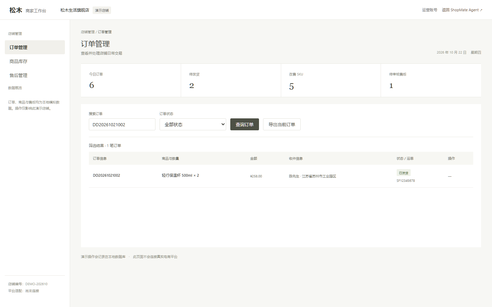
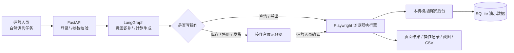

# ShopMate 电商商家操作 Agent

ShopMate 是一个面向中国电商运营流程的商家后台操作 Agent 原型。运营人员用自然语言描述任务，系统把任务整理成结构化计划，再通过浏览器操作本地模拟商家后台。

它覆盖订单查询与导出、商品库存与售价查询、库存/价格变更、模拟发货和售后查询。所有写操作都会先展示目标对象与变更内容，运营人员确认后才执行。

> **当前是本地演示项目。** 示例店铺、订单、商品、收件信息、售后记录和运单均为虚构数据。没有接入淘宝、天猫、拼多多、抖店或其他真实平台，也不会发起真实发货、退款或付款。



## 主要能力

| 场景 | 当前实现 |
| --- | --- |
| 订单查询 | 按订单号、商品、收件人或订单状态筛选，并展示页面结果 |
| 订单导出 | 在模拟后台按状态筛选并导出 UTF-8 BOM CSV |
| 商品查询 | 按商品名称或 SKU 查看售价、库存与状态 |
| 库存调整 | 预览商品、旧库存和新库存；确认后由浏览器填写并保存 |
| 售价调整 | 预览商品、旧售价和新售价；确认后由浏览器填写并保存 |
| 模拟发货 | 校验订单状态，预览运单号；确认后录入并核对“已发货”状态 |
| 售后查询 | 查询申请类型、原因、状态和关联订单；不自动审核或退款 |
| 操作留痕 | 保存任务计划、确认状态、执行步骤、结果和后台截图 |

查询和导出属于只读操作，可以直接执行；库存、售价和发货会改变业务状态，必须经过操作台确认。缺少订单号、商品或目标数值时，系统会要求补充信息。

## 技术栈

| 技术 | 用途 |
| --- | --- |
| Python 3.11+ | 后端与业务逻辑 |
| FastAPI、Pydantic | REST API、请求校验、登录态与接口依赖 |
| LangGraph | 把任务识别和计划生成组织成显式工作流 |
| Playwright | 通过可访问名称、表格行和按钮操作模拟商家后台，并保存截图/CSV |
| SQLite | 保存模拟订单、商品、售后、操作记录和审计事件 |
| HTML、CSS、原生 JavaScript | 商家操作台与本地模拟后台，无前端构建步骤 |
| Uvicorn | 本地 ASGI 服务 |

当前 Agent 用确定性规则识别意图和提取参数，LangGraph 编排“理解任务 → 生成计划”两个节点；没有使用大模型自由决定或直接执行写操作。没有配置模型密钥也可运行。

## 架构与操作流程



浏览器执行器只允许访问 `http://127.0.0.1:8765` 或 `http://localhost:8765`，只接受预定义的任务类型和参数，不接受用户提供的任意网址或 JavaScript。每次执行使用独立 Playwright 浏览器上下文。商家操作 API 仅允许 `operator` 运营账号访问，并沿用会话 CSRF 校验。

## 本地运行

### 环境要求

- Windows 10/11
- Python 3.11 或更高版本
- Google Chrome（默认路径 `C:\Program Files\Google\Chrome\Application\chrome.exe`）
- 首次运行安装 Python 依赖时需要网络

Playwright 使用本机 Chrome，无需额外下载 Playwright Chromium。若 Chrome 安装在其他位置，可设置 `SHOPMATE_CHROME_PATH`。

### 启动

克隆仓库后，在 Windows 文件管理器中双击 `start.bat`，或在 PowerShell 运行：

```powershell
git clone https://github.com/sbzz666/shopmate-ecommerce-agent.git
cd .\shopmate-ecommerce-agent
.\start.ps1
```

然后访问：

- 操作台：<http://127.0.0.1:8765>
- 模拟商家后台：<http://127.0.0.1:8765/mock-admin>
- API 文档：<http://127.0.0.1:8765/docs>

演示运营账号：`operator / operator123`。仅供本地演示，不要用于公网部署。首次启动会初始化 `data/shopmate.db` 并生成虚构店铺数据；`data/`、`.venv/`、`.env` 和操作截图/导出文件默认被 Git 忽略。

### 示例任务

```text
查待发货订单
导出待发货订单
查询轻行保温杯 500ml 库存
将轻行保温杯 500ml 库存改成 130
将桌面机械键盘 Air 售价调到 279 元
给订单 DD20261021001 发货，运单号 SF12345678
查询待审核售后记录
```

修改库存、售价或发货时，先检查操作预览，再点击“确认执行”。

## 项目结构

```text
app/
  main.py              FastAPI 路由、登录、确认闸门、操作记录与审计
  ops_agent.py         LangGraph 任务识别、参数提取和计划生成
  browser_operator.py  固定本地目标的 Playwright 执行器
  store.py             SQLite 初始化、模拟业务数据与查询
  agent.py             旧版客服 Agent 兼容代码
web/
  index.html           商家操作台
  app.js               前端登录、任务计划、确认与记录展示
  mock-admin.html      本地模拟商家后台
  mock-admin.js        模拟后台查询与业务操作
  style.css / mock.css 界面样式
docs/
  project-brief.md     项目范围、验收标准与限制
  interview-guide.md   项目讲解与面试参考
  verification.md      本地手工验收记录
tests/                 旧版客服 Agent 的自动化测试
```

## 主要接口

- `POST /api/ops/plan`：识别自然语言任务并生成计划。查询任务直接执行，写操作返回待确认任务。
- `POST /api/ops/confirm`：确认并执行尚未过期的写操作计划。
- `GET /api/ops/runs`：读取当前运营账号的任务记录。
- `/api/ops/console/*`：模拟后台的订单、商品、售后、导出与动作接口。
- `GET /api/ops/screenshot/{name}`、`GET /api/ops/download/{name}`：读取本地操作截图和导出文件。

## 安全与当前边界

- 只使用虚构的单店铺数据；真实店铺登录凭据和平台 Token 不在项目中。
- 变更库存、售价和发货信息必须由人确认；确认计划有时效且只能执行一次。
- 执行器限制在本地固定地址，拒绝外部域名和任意脚本。
- 运营接口只接受商家运营账号；写接口执行会话 CSRF 校验并写入本地审计事件。
- 当前是单机、单店和单进程原型；令牌保存在进程内存，不适合公网、多商户或生产数据。
- 售后只读，不批准/拒绝售后，不执行真实退款、付款、物流或客服消息。

真实平台接入尚未实现。接入淘宝/天猫、拼多多或抖店之前，需要确定目标平台、应用资质、商家授权和 API 权限；优先实现官方授权 API 适配器。只有 API 不覆盖且平台规则允许时，才评估受控浏览器自动化。真实试用还需要补齐租户隔离、授权凭证管理、限流、幂等、审计保留、备份与监控。

## 技术验证

本地浏览器手工走查覆盖了订单查询/导出、商品查询、库存和售价确认变更、模拟发货及售后查询。JavaScript 语法检查和 Python 编译检查通过。详细记录见 [docs/verification.md](docs/verification.md)。这不等于真实平台、并发、渗透或生产部署验收。

## 简历描述参考

**ShopMate 电商商家操作 Agent｜个人实战项目**

- 基于 FastAPI、LangGraph、SQLite 与 Playwright 构建电商运营后台操作原型，实现订单查询/导出、商品库存与售价调整、售后查询及模拟发货。
- 设计“任务解析 → 结构化计划 → 写操作人工确认 → 浏览器执行 → 页面状态核验”的流程，记录任务状态、执行步骤、截图与 CSV 导出。
- 将浏览器执行目标限制为本机模拟后台，并对运营接口实施身份与 CSRF 校验；真实平台 API 尚未接入。

请按自己能解释和验证的内容写简历，不要描述为已接入真实平台、生产上线或已实现的业务收益。
